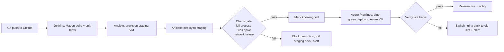

# ResilienceOps: Self-Healing CI/CD Pipeline with Automated Chaos Engineering Gates

CS23016 DevOps project. A CI/CD pipeline where surviving failure is a release requirement: every
build is deployed to staging, deliberately broken by chaos experiments, and promoted to production
only if it heals itself within a recovery window. If it doesn't, promotion is blocked, staging is
rolled back to the last known-good build, and an alert is sent.

## Pipeline



| Tool | Role in this project | Where |
|---|---|---|
| Git / GitHub | Version control and source repository | this folder |
| Maven | Builds and unit-tests the Java service | `app/pom.xml` |
| Jenkins | CI: build, test, staging deploy, chaos gate, promotion | `Jenkinsfile` |
| Ansible | Infrastructure as code (provision, deploy, blue-green) **and** chaos playbooks | `ansible/` |
| Azure DevOps (Pipelines) | CD: blue-green release, verification, automatic rollback | `azure-pipelines.yml` |
| Azure VM | Production host: blue and green slots behind nginx | `ansible/bluegreen_*.yml` |

## What is in the repository

```
app/                      Java 17 service under test (no frameworks; 7 JUnit tests)
downstream/quote_service.py  the app's dependency, targeted by the network-failure experiment
monitoring/
  resilience_gate.py      monitoring layer + gate: injects faults, probes, judges, writes reports
  experiments.json        staging experiments (Ansible chaos playbooks) and thresholds
  experiments-local.json  same experiments with local fault injectors
ansible/
  provision.yml           installs Java, nginx, stress-ng, iptables; quote service
  deploy_staging.yml      deploys the build to staging (systemd, Restart=always)
  mark_good.yml           remembers a build that passed the gate
  rollback_staging.yml    restores the last known-good build
  bluegreen_deploy.yml    deploys to the idle slot, smoke-tests it, switches nginx
  bluegreen_rollback.yml  switches nginx back to the previous slot
  chaos/kill_process.yml  SIGKILL the app
  chaos/cpu_spike.yml     stress-ng on every core
  chaos/network_failure.yml  iptables DROP to the dependency, always restored
scripts/
  local_demo.py           runs the whole gate on one machine (no VMs needed)
  local_chaos.py          local fault injectors used by the demo
  alert.py                Slack/Teams webhook alert
  trigger_azure_release.py  Jenkins -> Azure Pipelines handoff (REST API)
  verify_production.py    post-switch check of live traffic
Jenkinsfile, azure-pipelines.yml, Vagrantfile
docs/case-study.md        failure detected + automated recovery, with measured results
```

## How the app heals itself

| Failure (chaos experiment) | Self-healing mechanism | Gate passes when |
|---|---|---|
| Process killed with SIGKILL | systemd `Restart=always`, `RestartSec=2` | a new process (new `instanceId`) serves within 20 s and ends UP |
| CPU saturated by stress-ng | lightweight thread-pool server | ≥ 95 % of requests succeed and p95 latency ≤ 1500 ms |
| Network to dependency dropped | graceful degradation: cached quote, `/health` = DEGRADED | ≥ 95 % of requests succeed, fallback responses seen, back to UP afterwards |

Setting `self_healing_enabled=false` (Jenkins parameter `SELF_HEALING_ENABLED`) deploys a
**fragile** build: `Restart=no` and no fallback. The gate is expected to block it; that is the
"failure detected" half of the case study.

The gate checks that each fault really happened (the process ID changed, fallback responses
appeared), so a broken chaos playbook cannot produce a false pass.

## Run it locally (Windows, macOS or Linux; no VMs)

Needs Java 17+, Maven and Python 3.8+.

```bash
cd app && mvn -B clean verify && cd ..
python scripts/local_demo.py              # resilient build: GATE PASSED
python scripts/local_demo.py --fragile    # fragile build:  GATE FAILED
```

The demo uses ports 18080 and 19090 (change with `--port` / `--downstream-port`). Reports
(JSON + JUnit XML per experiment) go to `reports/local-resilient/` and `reports/local-fragile/`.

## Run the full pipeline

1. **Staging VM.** `vagrant up` gives Ubuntu 22.04 at 192.168.56.10. Any Ubuntu 22.04 VM works;
   pass its address as the `STAGING_HOST` parameter.
2. **Jenkins.** Agent with JDK 17, Maven, Python 3 and Ansible (`pip install ansible-core`).
   Plugins: Pipeline, Git, SSH Agent, JUnit, Credentials Binding.
   Credentials: `staging-ssh` (SSH key for the staging user), `azure-devops-pat` (secret text).
   Global environment variables: `AZDO_ORG`, `AZDO_PROJECT`, `AZDO_PIPELINE_ID`, and optionally
   `ALERT_WEBHOOK_URL`. Create a Pipeline job from SCM pointing at this repository's `Jenkinsfile`.
3. **Azure.** Create an Ubuntu 22.04 VM with ports 22 and 80 open. In Azure DevOps create a
   pipeline from `azure-pipelines.yml`, a variable group `resilienceops-production`
   (`PROD_HOST`, `PROD_USER`, `ALERT_WEBHOOK_URL`), a secure file `resilienceops_prod_key`
   (the VM's SSH private key) and an environment `resilienceops-production`.
4. Run the Jenkins job. With `SELF_HEALING_ENABLED` ticked the build passes the gate and Jenkins
   starts the Azure release; unticked, the gate fails, staging rolls back and an alert is sent.

## Verified so far

- Maven build and all 7 unit tests pass.
- The chaos gate was run end to end on a Windows laptop with the local demo, for both the
  resilient and the fragile build (results in `docs/case-study.md`).
- All 9 Ansible playbooks pass `ansible-playbook --syntax-check`; all YAML, JSON and Python files parse.

Not yet run: the Jenkins job, the Ansible playbooks against a real staging VM, and the Azure
blue-green release. These need the VM, Jenkins and Azure accounts described above.
